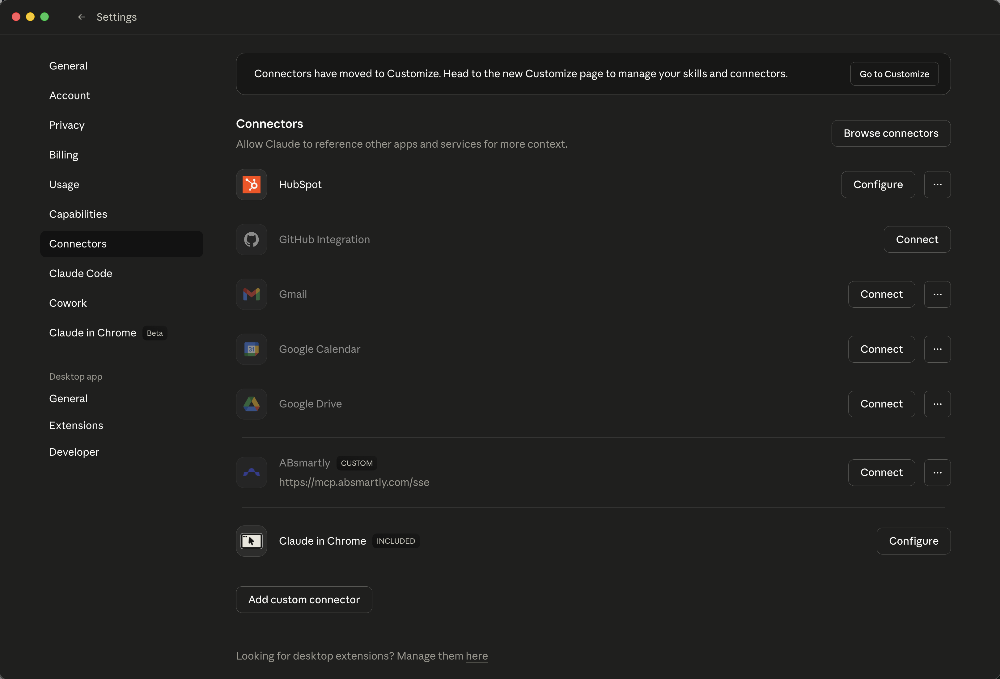
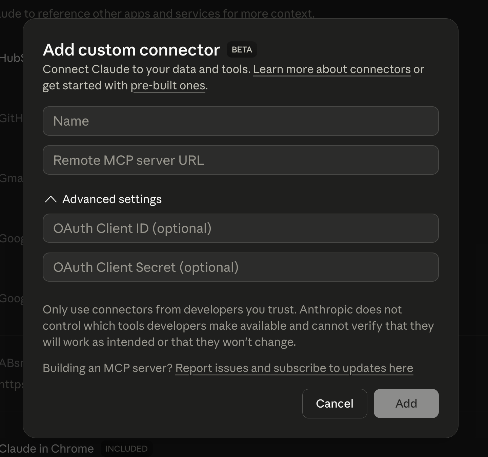
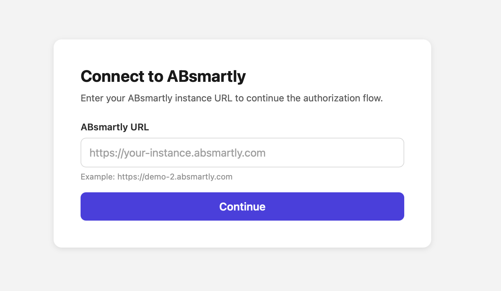

import Tabs from "@theme/Tabs";
import TabItem from "@theme/TabItem";
import BrowserOnly from "@docusaurus/BrowserOnly";

export const vscodeInstallUrl = "vscode:mcp/install?" + encodeURIComponent('{"name":"absmartly","type":"sse","url":"https://mcp.absmartly.com/sse"}');
export const vscodeInsidersInstallUrl = "vscode-insiders:mcp/install?" + encodeURIComponent('{"name":"absmartly","type":"sse","url":"https://mcp.absmartly.com/sse"}');
export const cursorInstallUrl = "cursor://anysphere.cursor-deeplink/mcp/install?name=absmartly&config=" + btoa('{"url":"https://mcp.absmartly.com/sse"}');

export const VSCodeInstallLinks = () => (
  <BrowserOnly>
    {() => (
      <span>
        <a href={vscodeInstallUrl}>Install in VS Code</a>{" · "}
        <a href={vscodeInsidersInstallUrl}>Install in VS Code Insiders</a>
      </span>
    )}
  </BrowserOnly>
);

export const CursorInstallLink = () => (
  <BrowserOnly>
    {() => <a href={cursorInstallUrl}>Add to Cursor</a>}
  </BrowserOnly>
);

The ABsmartly MCP server can be added to any MCP-compatible client. This page
covers Claude Desktop, Claude Code, Cursor, Windsurf, VS Code (Copilot), Gemini
(CLI, Code Assist and Enterprise), ChatGPT, Goose, GitHub Copilot CLI, cloud
agent platforms and the DXT extension.

For details on API keys and supported `Authorization` header formats, see
[Authentication](./authentication). For how OAuth clients are registered and
which ones are accepted, see [OAuth & Client Registration](./oauth-clients).

## Transports

The server is reachable on two HTTP endpoints:

| Endpoint | Transport | Notes |
| --- | --- | --- |
| `https://mcp.absmartly.com/mcp` | **Streamable HTTP** | Modern MCP transport (recommended for new installs). |
| `https://mcp.absmartly.com/sse` | **SSE** | Legacy transport. Still works; required by some older clients. |

The MCP spec deprecated SSE in March 2025, but `/sse` continues to be supported
for compatibility.

### Your instance's own `/mcp` endpoint

Your ABsmartly instance also serves MCP directly:

```text
https://your-instance.absmartly.com/mcp
```

It uses **Streamable HTTP** only, and accepts OAuth through your instance's own
login, or an API key sent as `Authorization: Api-Key YOUR_API_KEY`. Because the
URL already identifies your instance, no `absmartly-endpoint` parameter or
`x-absmartly-endpoint` header is needed. Use this URL in place of
`https://mcp.absmartly.com/mcp` in any of the Streamable HTTP examples below.
See [OAuth & Client Registration](./oauth-clients#two-ways-to-connect-with-oauth)
for how the two differ.

### Local stdio

You can also run the server locally over stdio with `npx @absmartly/mcp`, which
reuses your ABsmartly CLI config and macOS Keychain credentials.

---

## Claude Desktop

<Tabs groupId="claude-desktop-auth">
<TabItem value="oauth" label="OAuth (recommended)" default>

Open **Settings → Connectors**, scroll to the bottom, and click
**Add custom connector**.



In the dialog, give the connector a name (e.g. `ABsmartly`) and paste the URL
into **Remote MCP server URL**:



**URL:**

```text
https://mcp.absmartly.com/mcp?absmartly-endpoint=https://your-instance.absmartly.com
```

Click **Add**, then **Connect**. Claude Desktop will open your browser. Approve
the consent page, then sign in to ABsmartly (SAML/credentials). After
authentication, the MCP connection is established automatically.

You can also use your instance's own endpoint,
`https://your-instance.absmartly.com/mcp`, as the URL.

:::tip
The `absmartly-endpoint` query parameter is optional. If omitted, the OAuth flow
will prompt you to enter the URL of your ABsmartly instance in the browser before
login:


:::

</TabItem>
<TabItem value="apikey-url" label="API Key (URL)">

Pass the API key directly in the URL — no `mcp-remote` bridge required:

```text
https://mcp.absmartly.com/sse?api_key=YOUR_API_KEY&absmartly-endpoint=https://your-instance.absmartly.com
```

</TabItem>
<TabItem value="apikey-headers" label="API Key (headers via mcp-remote)">

To pass the key via headers instead of the URL, use the `mcp-remote` bridge —
Claude Desktop doesn't support custom headers natively for remote servers.

**`~/Library/Application Support/Claude/claude_desktop_config.json`** (macOS):

```json
{
  "mcpServers": {
    "absmartly": {
      "command": "npx",
      "args": [
        "mcp-remote@latest",
        "https://mcp.absmartly.com/sse",
        "--header", "Authorization:YOUR_API_KEY",
        "--header", "x-absmartly-endpoint:https://your-instance.absmartly.com"
      ]
    }
  }
}
```

</TabItem>
<TabItem value="stdio" label="Local stdio">

Uses your ABsmartly CLI config and macOS Keychain credentials:

```json
{
  "mcpServers": {
    "absmartly": {
      "command": "npx",
      "args": ["@absmartly/mcp", "--profile=production"]
    }
  }
}
```

</TabItem>
</Tabs>

---

## Claude Code

<Tabs groupId="claude-code-auth">
<TabItem value="sse-apikey" label="Remote · API Key (SSE)" default>

```bash
claude mcp add --transport sse --scope user absmartly \
  https://mcp.absmartly.com/sse \
  -H "Authorization:YOUR_API_KEY" \
  -H "x-absmartly-endpoint:https://your-instance.absmartly.com"
```

**Subdomain shorthand** — auto-constructs `https://<subdomain>.absmartly.com/v1`:

```bash
claude mcp add --transport sse --scope user absmartly \
  https://mcp.absmartly.com/sse \
  -H "Authorization:my-subdomain YOUR_API_KEY"
```

</TabItem>
<TabItem value="http-apikey" label="Remote · API Key (Streamable HTTP)">

Recommended for new installations:

```bash
claude mcp add --transport http --scope user absmartly \
  https://mcp.absmartly.com/mcp \
  -H "Authorization:YOUR_API_KEY" \
  -H "x-absmartly-endpoint:https://your-instance.absmartly.com"
```

:::info
Streamable HTTP is the modern MCP transport. The `/sse` URL still works for
older clients.
:::

</TabItem>
<TabItem value="oauth" label="Remote · OAuth">

```bash
claude mcp add --transport sse --scope user absmartly \
  "https://mcp.absmartly.com/sse?absmartly-endpoint=https://your-instance.absmartly.com"
```

Then run `/mcp` in Claude Code to authenticate when prompted. The
`absmartly-endpoint` query parameter is optional — omit it and the OAuth flow
will prompt you for the instance URL in the browser.

</TabItem>
<TabItem value="stdio" label="Local stdio">

```bash
claude mcp add --scope user absmartly -- npx @absmartly/mcp --profile=production
```

</TabItem>
<TabItem value="project" label="Project config (.mcp.json)">

```json
{
  "mcpServers": {
    "absmartly": {
      "type": "sse",
      "url": "https://mcp.absmartly.com/sse",
      "headers": {
        "Authorization": "YOUR_API_KEY",
        "x-absmartly-endpoint": "https://your-instance.absmartly.com"
      }
    }
  }
}
```

Use `--scope project` instead of `--scope user` to write to `.mcp.json` (shared
via version control).

</TabItem>
</Tabs>

---

## Cursor

One-click install (OAuth): <CursorInstallLink />. Cursor will prompt you for the ABsmartly instance URL in the browser, then the flow completes automatically.

Or configure manually in **`.cursor/mcp.json`** (project) or
**`~/.cursor/mcp.json`** (global):

<Tabs groupId="cursor-auth">
<TabItem value="apikey-sse" label="API Key (SSE)" default>

```json
{
  "mcpServers": {
    "absmartly": {
      "url": "https://mcp.absmartly.com/sse",
      "headers": {
        "Authorization": "YOUR_API_KEY",
        "x-absmartly-endpoint": "https://your-instance.absmartly.com"
      }
    }
  }
}
```

</TabItem>
<TabItem value="apikey-http" label="API Key (Streamable HTTP)">

Modern transport, recommended:

```json
{
  "mcpServers": {
    "absmartly": {
      "type": "http",
      "url": "https://mcp.absmartly.com/mcp",
      "headers": {
        "Authorization": "YOUR_API_KEY",
        "x-absmartly-endpoint": "https://your-instance.absmartly.com"
      }
    }
  }
}
```

</TabItem>
<TabItem value="oauth" label="OAuth">

```json
{
  "mcpServers": {
    "absmartly": {
      "url": "https://mcp.absmartly.com/sse?absmartly-endpoint=https://your-instance.absmartly.com"
    }
  }
}
```

Cursor will detect the OAuth requirement and open your browser for login. The
`absmartly-endpoint` query parameter is optional.

</TabItem>
<TabItem value="stdio" label="Local stdio">

```json
{
  "mcpServers": {
    "absmartly": {
      "command": "npx",
      "args": ["@absmartly/mcp", "--profile=production"]
    }
  }
}
```

</TabItem>
</Tabs>

---

## Windsurf

Configure **`~/.codeium/windsurf/mcp_config.json`**:

:::note
Windsurf uses `"serverUrl"` (not `"url"`).
:::

<Tabs groupId="windsurf-auth">
<TabItem value="apikey-sse" label="API Key (SSE)" default>

```json
{
  "mcpServers": {
    "absmartly": {
      "serverUrl": "https://mcp.absmartly.com/sse",
      "headers": {
        "Authorization": "YOUR_API_KEY",
        "x-absmartly-endpoint": "https://your-instance.absmartly.com"
      }
    }
  }
}
```

</TabItem>
<TabItem value="apikey-http" label="API Key (Streamable HTTP)">

```json
{
  "mcpServers": {
    "absmartly": {
      "serverUrl": "https://mcp.absmartly.com/mcp",
      "headers": {
        "Authorization": "YOUR_API_KEY",
        "x-absmartly-endpoint": "https://your-instance.absmartly.com"
      }
    }
  }
}
```

</TabItem>
<TabItem value="oauth" label="OAuth">

```json
{
  "mcpServers": {
    "absmartly": {
      "serverUrl": "https://mcp.absmartly.com/sse?absmartly-endpoint=https://your-instance.absmartly.com"
    }
  }
}
```

</TabItem>
<TabItem value="stdio" label="Local stdio">

```json
{
  "mcpServers": {
    "absmartly": {
      "command": "npx",
      "args": ["@absmartly/mcp", "--profile=production"]
    }
  }
}
```

</TabItem>
</Tabs>

---

## VS Code (GitHub Copilot)

One-click install (OAuth): <VSCodeInstallLinks />. You'll be prompted for your ABsmartly instance URL in the browser.

Or configure manually in **`.vscode/mcp.json`** (workspace) or via Command
Palette → **MCP: Open User Configuration**.

:::note
VS Code uses `"servers"` as the root key (not `"mcpServers"`).
:::

<Tabs groupId="vscode-auth">
<TabItem value="apikey-sse" label="API Key (SSE)" default>

```json
{
  "servers": {
    "absmartly": {
      "type": "sse",
      "url": "https://mcp.absmartly.com/sse",
      "headers": {
        "Authorization": "${input:absmartly-api-key}",
        "x-absmartly-endpoint": "https://your-instance.absmartly.com"
      }
    }
  },
  "inputs": [
    {
      "type": "promptString",
      "id": "absmartly-api-key",
      "description": "ABsmartly API Key",
      "password": true
    }
  ]
}
```

</TabItem>
<TabItem value="apikey-http" label="API Key (Streamable HTTP)">

Recommended:

```json
{
  "servers": {
    "absmartly": {
      "type": "http",
      "url": "https://mcp.absmartly.com/mcp",
      "headers": {
        "Authorization": "${input:absmartly-api-key}",
        "x-absmartly-endpoint": "https://your-instance.absmartly.com"
      }
    }
  },
  "inputs": [
    {
      "type": "promptString",
      "id": "absmartly-api-key",
      "description": "ABsmartly API Key",
      "password": true
    }
  ]
}
```

</TabItem>
<TabItem value="oauth" label="OAuth">

```json
{
  "servers": {
    "absmartly": {
      "type": "sse",
      "url": "https://mcp.absmartly.com/sse?absmartly-endpoint=https://your-instance.absmartly.com"
    }
  }
}
```

VS Code will detect the OAuth requirement and show an **Auth** CodeLens to
trigger the flow. The `absmartly-endpoint` query parameter is optional.

</TabItem>
<TabItem value="stdio" label="Local stdio">

```json
{
  "servers": {
    "absmartly": {
      "command": "npx",
      "args": ["@absmartly/mcp", "--profile=production"]
    }
  }
}
```

</TabItem>
</Tabs>

:::caution
MCP tools only appear in **Agent mode** in VS Code, not in Ask or Edit mode.
:::

---

## Gemini (CLI + Code Assist)

Works for **Gemini CLI** (terminal) and **Gemini Code Assist** (VS Code,
JetBrains, Android Studio agent mode). Both read `~/.gemini/settings.json`
(user-wide) or `.gemini/settings.json` (per-project). JetBrains IDEs use
`mcp.json` instead.

<Tabs groupId="gemini-auth">
<TabItem value="oauth" label="OAuth" default>

```json
{
  "mcpServers": {
    "absmartly": {
      "url": "https://mcp.absmartly.com/sse?absmartly-endpoint=https://your-instance.absmartly.com"
    }
  }
}
```

Gemini auto-discovers the OAuth requirement. In Gemini CLI, run
`/mcp auth absmartly` when prompted; in Code Assist agent mode the browser opens
automatically.

</TabItem>
<TabItem value="apikey" label="API Key">

```json
{
  "mcpServers": {
    "absmartly": {
      "url": "https://mcp.absmartly.com/sse",
      "headers": {
        "Authorization": "YOUR_API_KEY",
        "x-absmartly-endpoint": "https://your-instance.absmartly.com"
      }
    }
  }
}
```

</TabItem>
<TabItem value="oneliner" label="Gemini CLI one-liner">

```bash
gemini mcp add --transport sse --scope user absmartly \
  https://mcp.absmartly.com/sse \
  -H "Authorization: YOUR_API_KEY" \
  -H "x-absmartly-endpoint: https://your-instance.absmartly.com"
```

</TabItem>
</Tabs>

### Gemini Enterprise (Google Cloud Console)

Gemini Enterprise's **Custom MCP Server** connector (Preview) requires
Streamable HTTP transport — use the `/mcp` endpoint:

1. Google Cloud Console → **Gemini Enterprise** → **Data stores** →
   **Create data store**.
2. Search "Custom MCP Server" → **Add MCP server**.
3. **Server URL:**
   `https://mcp.absmartly.com/mcp?absmartly-endpoint=https://your-instance.absmartly.com`
4. **Authentication:** OAuth. Gemini Enterprise registers itself
   automatically through dynamic client registration, using the callback
   `https://vertexaisearch.cloud.google.com/oauth-redirect`. Grant the
   `mcp:access` scope.
5. Save and wait for the connector status to become **Active**.

When you first authorize, the consent page shows a warning that the Google
callback is shared by all Gemini Enterprise customers. Approve only if you just
started the connection yourself.

:::tip If Gemini Enterprise asks for a client ID and secret
If the console asks you for a `client_id` and `client_secret` instead of
registering automatically, register a client yourself once and paste the
values in. See [Manual registration](./oauth-clients#manual-registration).
:::

:::caution
SSE transport (`/sse`) is **not** supported by this connector. The Gemini
CLI / Code Assist sections above continue to use `/sse` until those clients add
Streamable HTTP support.

Reload the IDE window after editing settings (VS Code: Command Palette →
**Developer: Reload Window**). MCP support in Code Assist requires
**agent preview mode** — set `"geminicodeassist.updateChannel": "Insiders"` in
VS Code settings if not already enabled.
:::

---

## ChatGPT (Developer Mode)

ChatGPT does not support one-click install deeplinks — you connect remote MCP
servers via the **Custom Connectors** UI. Requires a Pro, Team, Enterprise or
Edu plan, and Developer Mode enabled (Settings → **Connectors** →
**Advanced** → **Developer mode**).

1. Go to **Settings → Connectors → Create**.
2. Fill in:
   - **Name:** `ABsmartly`
   - **MCP Server URL:**
     `https://mcp.absmartly.com/mcp?absmartly-endpoint=https://your-instance.absmartly.com`
   - **Authentication:** OAuth (ChatGPT registers itself automatically through
     dynamic client registration)
3. Save. In a new chat, click **+** → **Developer mode** → select the
   **ABsmartly** connector to add it as a tool source.

:::note
Workspace admins must first enable **Custom MCP connectors** in
**Workspace Settings → Permissions & Roles → Connected Data**.
:::

---

## Goose

Goose identifies itself with a trusted client metadata document, so no
registration step is needed. Run `goose configure` (or open **Extensions** in
Goose Desktop), choose **Add Extension → Remote Extension (Streamable HTTP)**,
skip custom headers, and use the URL:

```text
https://mcp.absmartly.com/mcp?absmartly-endpoint=https://your-instance.absmartly.com
```

Goose opens your browser to sign in the first time it connects.

---

## GitHub Copilot CLI

GitHub Copilot CLI also uses a trusted client metadata document. Add the
server from the terminal:

```bash
copilot mcp add --transport http absmartly \
  "https://mcp.absmartly.com/mcp?absmartly-endpoint=https://your-instance.absmartly.com"
```

Or add it to **`~/.copilot/mcp-config.json`**:

```json
{
  "mcpServers": {
    "absmartly": {
      "type": "http",
      "url": "https://mcp.absmartly.com/mcp?absmartly-endpoint=https://your-instance.absmartly.com",
      "tools": ["*"]
    }
  }
}
```

Copilot CLI opens your browser to sign in the first time it uses the server.

---

## Cloud agent platforms

Hosted agent platforms connect to the MCP server from their own cloud, and
register themselves through dynamic client registration. Point them at the
hosted Streamable HTTP endpoint and choose OAuth:

```text
https://mcp.absmartly.com/mcp?absmartly-endpoint=https://your-instance.absmartly.com
```

| Platform | Notes |
| --- | --- |
| **Amazon Bedrock AgentCore** | Add an OAuth outbound credential provider for the MCP target. Its callback (`https://bedrock-agentcore.<region>.amazonaws.com/identities/oauth2/callback/<uuid>`) is accepted in every region. |
| **Microsoft Copilot Studio / Azure AI Foundry** | Add an MCP tool with OAuth 2.0 and dynamic discovery. Callbacks on `https://global.consent.azure-apim.net/redirect` are accepted. |
| **Perplexity** | Add a custom connector with OAuth. Both `www.perplexity.ai` and `enterprise.perplexity.ai` are accepted. |
| **Gemini Enterprise** | See [Gemini Enterprise](#gemini-enterprise-google-cloud-console) above. |

These platforms use callback URLs shared by all their customers, so the consent
page shows an extra warning. If a platform asks you for a client ID and secret
instead of registering itself, see
[Manual registration](./oauth-clients#manual-registration). If it can't use
OAuth at all, use an [API key](./authentication#api-key).

---

## Other clients

Any MCP client that supports OAuth with dynamic client registration or a
trusted client metadata document, and uses an
[allowed redirect URI](./oauth-clients#allowed-redirect-uris), works with the
same URL as above. Local clients that sign in through a `localhost` callback,
such as Zed, Kiro, OpenCode or MCP Inspector, are accepted automatically.

If your client is rejected, connect with an API key instead, or see
[Your client isn't on the list?](./oauth-clients#your-client-isnt-on-the-list).

---

## DXT Extension

1. Download from
   [mcp.absmartly.com/absmartly-mcp.dxt](https://mcp.absmartly.com/absmartly-mcp.dxt).
2. Double-click to install in Claude Desktop.
3. Enter your ABsmartly endpoint when prompted.
